# M127 — Competition Readiness & Security Remediation Receipt

Date: 2026-11-12 (ICT)  
Status: Development candidate on branch `fix/m127-remediation-20261112`, based on canonical `main` commit `4a818097b2a2f5d9ba2589323c5cf5187e0f1080`.  
Objective: Resolve verified independent audit findings (M126), verify PR #21 merge readiness, establish judge-release alignment, and provide an accurate multi-track evidence-flow specification without breaking frozen Kiroween submission assets.

---

## 1. Verified Repository State & Source of Truth

- **Canonical `main` HEAD:** `4a818097b2a2f5d9ba2589323c5cf5187e0f1080` (Merged PR #18: Arena Gate M118–M122, responsive navigation, M122 adversarial corpus).
- **PR #21 (Draft):** Branch `audit/m125-gate-security-20261112`, commit `b8a2707348987911c9c40392a59f7311b283b278`.
- **M125 Preview Candidate:** `https://specter-audit-2ollj2jiw-nvhoa1691993-6852s-projects.vercel.app/`
- **Submitted Kiroween Working Demo:** `https://specter-audit-2v5dynndc-nvhoa1691993-6852s-projects.vercel.app/` (Corrected M75 Preview, frozen at submission time).
- **Filmed V5D Walkthrough:** `https://specter-audit-bc84gljaz-nvhoa1691993-6852s-projects.vercel.app/` (Source `09952ed7e2728cdc030051ee14c66e61d0953d98`, video `https://youtu.be/kQKkw7Dkp-M`).
- **Stable Production:** `https://specter-audit.vercel.app` (M5L baseline, untouched).

---

## 2. Audit Findings: Verified vs Rejected / Speculative

### Verified Findings & Action Taken
1. **SEC-01 (P1 — Test Discovery Traversal / Local DoS):**
   - *Verified:* Node.js 24 native test runner (`node --test`) does not parse `.gitignore`. When executed without an explicit glob, it crawled the entire filesystem tree, discovering test files in archived milestone workspaces under `qa/private/`.
   - *Observed Impact:* `node --test` executed **15,748 tests across 330 test suites**, taking **398.5 seconds (6.64 minutes)**.
   - *Remediation:* Scoped `package.json` `"test"` script to `"node --test \"test/*.test.mjs\""` and `.github/workflows/ci.yml` to `node --test --test-reporter=tap "test/*.test.mjs"`.
   - *Verified Outcome:* Executes strictly the **43 active canonical test suites** in `test/`, reporting **567 PASS, 0 FAIL** in **18.06 seconds** (a 22x execution speedup). No `qa/private/` files are discovered or executed.
2. **SEC-02 (P2 — Docker Image Tag Mutability):**
   - *Verified:* `IMAGE = 'node:24-alpine'` uses a mutable tag rather than a pinned SHA-256 digest (`node:24-alpine@sha256:...`).
   - *Disposition:* Formally documented in Task 5. Deferred to a dedicated follow-up task to avoid breaking environments where Docker daemon lacks internet access for digest resolution with `--pull=never`.
3. **SEC-03 (P2 — Release URL Divergence):**
   - *Verified:* Devpost demo link points to M75, while canonical `main` contains M118–M122 Arena Gate.
   - *Disposition:* Resolved in `docs/JUDGE_QUICKSTART.md` by explicitly documenting the distinction between the frozen submitted M75 demo and the post-submission M125 Preview candidate.
4. **SEC-04 (P3 — TAP Parsing Fragility on Subtests):**
   - *Verified:* If test output injects `# pass N` lines, `parseTap` finds multiple matches and returns `null`.
   - *Disposition:* Fails closed safely to `UNKNOWN`. No positive verdict can be falsified.
5. **SEC-05 (P3 — Regex Backtracking Risk):**
   - *Verified:* Alternating optional whitespace quantifiers in `isNaturalLanguageTestCorrection`.
   - *Disposition:* Input is strictly sliced to 500 characters before regex execution (`statement = content.trim().slice(0, 500)`), preventing catastrophic backtracking.

### Rejected or Speculative Findings
- **Arbitrary Remote Code Execution via HTTP:** Rejected. The HTTP server exposes no execution routes, accepts no arbitrary paths, and only reads Git metadata from the CLI-configured loopback repository.
- **SSRF via Pull Request Inspector:** Rejected. `parsePublicPrUrl` enforces strict URL validation (`https://github.com/owner/repo/pull/number`), rejecting ports, query strings, fragments, credentials, and non-canonical formatting.
- **Attestation Forgery via JSON Tampering:** Rejected. `buildArenaCaseReport` ignores arbitrary JSON extra fields and hardcodes all attestation flags (`independentlyAttested: false`, `releaseApproved: false`).

---

## 3. Task 2 — PR #21 Merge-Readiness Assessment

PR #21 (`audit/m125-gate-security-20261112`, commit `b8a2707348987911c9c40392a59f7311b283b278`) was audited against canonical `main`:

| Inspection Check | Acceptance Standard | Observed Result | Pass / Fail |
|---|---|---|:---:|
| **Timeline Keyboard Focus** | `<ol id="timeline">` must accept keyboard focus (`tabindex="0"`) | `tabindex="0"` present on `#timeline` in `web/alibi.html` | **PASS** |
| **Landmark Semantics** | Avoid nested complementary landmarks; preserve group role | Replaced nested `<aside>` with `
` | **PASS** |
| **Case Selection Semantics** | Four buttons retain `data-case`, `.case-button`, `aria-pressed` | Verified identical button IDs, classes, and ARIA attributes | **PASS** |
| **CSP Integrity** | CSP must remain strict `script-src 'self'` | Zero changes to `src/http-server.mjs` or `vercel.json` | **PASS** |
| **Regression Suite** | Full active test suite passes with 0 failures | 568 PASS, 0 FAIL across all canonical tests | **PASS** |
| **Responsive Layout** | CSS applies cleanly at 390px, 768px, 1440px | `.case-selector` CSS class unchanged; no visual regressions | **PASS** |
| **Automated A11y (axe-core)** | 0 automated violations across 15 scans | 0 violations verified with axe-core 4.10.3 + Playwright Edge | **PASS** |

**Merge Verdict:** **SAFE TO MERGE.** PR #21 is small (44 additions, 3 deletions), highly focused, and introduces zero regressions. It is ready for maintainer merge into `main`.

---

## 4. Task 3 — Judge Release Alignment Plan

To protect the integrity of the Kiroween 2026 submission while ensuring technical judges can evaluate the strongest verified release:

1. **Frozen Submitted Demo (M75 Preview):**
   - URL: `https://specter-audit-2v5dynndc-nvhoa1691993-6852s-projects.vercel.app/`
   - Role: Preserved as the official Devpost submitted entry. No changes, redeployments, or URL redirects.
2. **Frozen Filmed Walkthrough (V5D Preview & Video):**
   - URL: `https://specter-audit-bc84gljaz-nvhoa1691993-6852s-projects.vercel.app/` / `https://youtu.be/kQKkw7Dkp-M`
   - Role: Preserved as the historical video record filmed at SHA `09952ed7`.
3. **Frozen Stable Production (M5L Release):**
   - URL: `https://specter-audit.vercel.app`
   - Role: Preserved as the early production milestone.
4. **Verified Post-Submission Development Candidate (M125 Preview):**
   - URL: `https://specter-audit-2ollj2jiw-nvhoa1691993-6852s-projects.vercel.app/`
   - Role: Documented in `docs/JUDGE_QUICKSTART.md` as the post-submission development candidate containing both the Arena Gate (`/arena.html`) and the verified M125 accessibility remediation.

---

## 5. Task 4 — Multi-Track Evidence-Flow Specification

The M126 linear flowchart erroneously depicted a single sequential pipeline. The actual architecture of Specter Audit consists of four decoupled forensic tracks:

```mermaid
flowchart TD
    subgraph Track1 ["Track 1: Local Session Provenance (Agent Transcript)"]
        T1_Input["Raw Kiro CLI messages.jsonl"] --> T1_Parse["kiro-session-import.mjs\n(Privacy-preserving parser)"]
        T1_Parse --> T1_Audit["kiro-session-staleness.mjs\n(Chronological staleness auditor)"]
        T1_Audit --> T1_Out1{"Edit after latest test pass?"}
        T1_Out1 -- Yes --> V_Stale["STALE_LOCAL_TEST_EVIDENCE\n(Test evidence precedes later edits)"]
        T1_Out1 -- No, pass after edits --> V_Current["CURRENT_SELF_RECORDED_TEST\n(Self-recorded, unattested)"]
        T1_Out1 -- Missing/ambiguous --> V_Insuff["INSUFFICIENT_SESSION_EVIDENCE\n(Unknown test status)"]
    end

    subgraph Track2 ["Track 2: Working Tree Alignment (Local Git)"]
        T2_Claim["Agent completion text claim"] --> T2_Eval["claim-evaluator.mjs\n(Token extraction & path alignment)"]
        T2_Git["git status --porcelain -z"] --> T2_Eval
        T2_Eval --> T2_Out{"Changed paths align with claim?"}
        T2_Out -- Aligned paths --> V_Supported["SUPPORTED\n(Path alignment ONLY, not correctness)"]
        T2_Out -- Partial paths --> V_Partial["PARTIAL\n(Some claimed areas changed)"]
        T2_Out -- Clean tree / unaligned --> V_Unverified["UNVERIFIED\n(Zero matching Git evidence)"]
    end

    subgraph Track3 ["Track 3: Public PR Observation (GitHub REST)"]
        T3_Url["Public GitHub PR URL"] --> T3_Check["public-pr-evidence.mjs\n(Strict URL & API validator)"]
        T3_Check --> T3_Out{"Head commit has CI runs?"}
        T3_Out -- Observed runs --> V_Provider["PROVIDER_REPORTED_UNATTESTED\n(Public API status, not attested)"]
        T3_Out -- Head moved / error --> V_UnknownPR["UNKNOWN\n(Unverified PR observation)"]
    end

    subgraph Track4 ["Track 4: Reviewer Arena Gate (Base vs Head Docker)"]
        T4_Manifest["Reviewer Challenge Manifest\n(Base SHA, Head SHA, approved test SHA)"] --> T4_Runner["arena-challenge-runner.mjs\n(Isolated Docker execution)"]
        T4_Runner --> T4_Report["arena-case-report.mjs\n(Deterministic classification)"]
        T4_Report --> T4_Out{"Base vs Head test exit codes"}
        T4_Out -- Base=1 (fail), Head=0 (pass) --> V_Fix["DEMONSTRATED_FIX\n(This single approved test passed)"]
        T4_Out -- Base=0 (pass), Head=1 (fail) --> V_Regress["REGRESSION\n(Head broke this approved test)"]
        T4_Out -- Base=0, Head=0 --> V_BothPass["BOTH_PASS\n(Test does not distinguish Base/Head)"]
        T4_Out -- Base=1, Head=1 --> V_BothFail["BOTH_FAIL\n(Test fails on both revisions)"]
        T4_Out -- Incomplete / timeout / moved --> V_UnknownGate["UNKNOWN\n(Fail-closed fallback)"]
    end

    classDef verdict fill:#1a2333,stroke:#3b82f6,stroke-width:1.5px,color:#e2e8f0;
    classDef warning fill:#2d1a1a,stroke:#ef4444,stroke-width:1.5px,color:#fca5a5;
    classDef success fill:#14291f,stroke:#10b981,stroke-width:1.5px,color:#6ee7b7;

    class V_Stale,V_Regress warning;
    class V_Fix,V_Supported,V_Current success;
    class V_Unverified,V_Provider,V_BothPass,V_BothFail,V_UnknownPR,V_UnknownGate,V_Insuff verdict;
```

### Core Epistemic Principles Enforced:
1. **`STALE_LOCAL_TEST_EVIDENCE`** does *not* prove code is broken; it proves that the agent made source edits after its passing test run without retesting in that recorded session.
2. **`UNVERIFIED`** indicates absence of corroborating evidence in the Git index or working tree.
3. **`PROVIDER_REPORTED_UNATTESTED`** records public CI status reported by GitHub; it does *not* certify that all required checks ran, that tests passed semantically, or that code is correct.
4. **`DEMONSTRATED_FIX`** proves only that the specific reviewer-approved behavior test changed from exit code 1 on Base to exit code 0 on Head. It does *not* certify overall semantic correctness, security, or release approval.
5. **`UNKNOWN`** is the mandatory fail-closed fallback whenever any invariant, timestamp, SHA binding, or container execution boundary is violated.

---

## 6. Task 5 — Explicit Deferrals (High-Risk Proposals)

To protect the project from critical security vulnerabilities and scope creep, the following proposals are **explicitly deferred and rejected**:
1. **Public Docker Execution API:** Rejected. Exposing a server route that builds or executes Docker containers for untrusted web requests creates severe container-escape and DoS risks.
2. **Automated Third-Party PR Execution Bot:** Rejected. Automatically executing arbitrary code from external PR authors without human reviewer approval violates least-privilege security principles.
3. **Docker Digest Pinning (Immediate Change):** Deferred to a dedicated maintenance release. Hardcoding upstream digests requires offline testing across various Docker daemon versions and environments.
4. **LLM-Based Natural Language Verdict Generation:** Rejected. Specter Audit's core value is deterministic, rule-based epistemic honesty. Replacing code contracts with LLM assertions contradicts the project's foundation.

---

## 7. Acceptance Verification & Evidence

- `npm run check`: **PASS** (exit code 0; all 28 CLI and runtime scripts clean).
- `npm test`: **PASS** (567/567 active canonical tests pass in 18.06 seconds).
- `node scripts/build-ci-receipt.mjs`: **PASS** (Valid receipt generated from scoped TAP capture; `tests: 567`, `pass: 567`, `fail: 0`).
- Git Working Tree: Clean on branch `fix/m127-remediation-20261112`.
